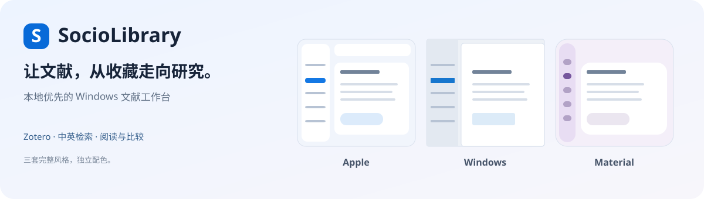

<a href="README.md">简体中文</a> · <strong>English</strong>

<strong>Keep your literature. Connect your thinking.</strong> A local-first workspace for Zotero, literature search, reading and research graphs.

<a href="https://github.com/Yoesher/SocioLibrary/releases/latest"><strong>Download</strong></a> · <a href="docs/en/quick-start.md">Get started</a> · <a href="docs/README.md">Documentation</a> · <a href="https://github.com/Yoesher/SocioLibrary/issues">Report an issue</a>

## Download

**Current version: 0.12.3** · Windows 10 / 11 x64 · macOS 15+ preview

| Your computer | Package | How to use it |
| --- | --- | --- |
| **Windows · Recommended** | [**Download installer**](https://github.com/Yoesher/SocioLibrary/releases/download/v0.12.3/SocioLibrary-0.12.3-Windows-x64-Setup.exe) | Install once; supports in-app upgrades |
| Windows · Portable | [Download complete ZIP](https://github.com/Yoesher/SocioLibrary/releases/download/v0.12.3/SocioLibrary-0.12.3-Windows-x64-Portable.zip) | Extract the entire folder and keep all program files |
| Mac · Apple silicon | [Download arm64 ZIP](https://github.com/Yoesher/SocioLibrary/releases/download/v0.12.3/SocioLibrary-0.12.3-macOS-arm64.zip) | Quit the previous version before replacing the app |
| Mac · Intel | [Download x86_64 ZIP](https://github.com/Yoesher/SocioLibrary/releases/download/v0.12.3/SocioLibrary-0.12.3-macOS-x86_64.zip) | Quit the previous version before replacing the app |

Existing Windows users can check for updates in the app, or quit and run the new installer over the existing installation. Your library, models, notes and settings are retained, with a local snapshot before upgrading. SHA-256 values are in the [release notes](https://github.com/Yoesher/SocioLibrary/releases/latest).

The application currently uses a Chinese interface. This landing page and the [quick-start guide](docs/en/quick-start.md) are available in English.

Mac preview and installation scope

Mac packages target macOS 15+. They are not Developer ID signed or notarized. The Intel preview does not include the local semantic inference runtime. Mac does not yet provide scanned-page OCR or automatic app replacement. Windows packages are unsigned; some computers need Microsoft WebView2 Runtime. Download from this repository and keep system protections enabled. [Mac guide, in Chinese](docs/macos.md)

## From collection to research

| Import and find | Read and compare | Connect and retain |
| --- | --- | --- |
| Read-only, incremental import of Zotero metadata, PDFs, notes and annotations | Source abstracts, query relevance and matching PDF pages for each paper | Explore a dynamic graph and inspect the basis for each relationship |
| Chinese-to-English retrieval; lexical, semantic and hybrid search | Open the corresponding attachment page in Zotero; save notes with source excerpts | Save named research graphs; export Obsidian canvases and literature notes |
| Author and year filters; saved and recent searches | Similar-paper recommendations, reading lists and structured comparisons | Select journal sources and discover new or corrected records monthly |

A graph view supports up to 80 papers, incremental expansion, pinned positions, paused motion and navigation history. Automatic links are reading leads. Check abstracts, page references and relationship explanations against the source. Detailed guides: [graphs and research exports](docs/v0.12-research-workspace.md), [recommendations, annotations and comparisons](docs/reading-tools.md) (Chinese).

## Get started in three steps

1. **Connect Zotero.** Keep Zotero running and allow local application communication in its advanced settings.
2. **Choose your sources.** In SocioLibrary, open “资料与设置” (Data and settings), choose permitted PDF folders, test the connection and sync.
3. **Start with a question.** Search, open a matching page, then continue into notes, comparisons or the graph. Semantic search needs a separately downloaded local model and an index; begin with a core collection for large libraries.

Lexical search works independently. Semantic inference runs locally. AI is optional: configure your own API and review and approve the selected material before each request. [English quick start](docs/en/quick-start.md) · [AI configuration, in Chinese](docs/ai.md)

## Your literature stays local

- Import uses Zotero's local interface. It **does not read or upload the Zotero database**. Original PDFs remain in place.
- The library, notes, indexes and stored credentials stay on your computer. Sync maintains derived indexes; it does not automatically delete papers or merge Zotero records.
- Local search and reading work offline. Journal discovery, model downloads, software updates and your selected AI service require a connection. Research material is sent to the configured AI endpoint only after your per-request approval.

How do journal subscriptions work?

Add an official RSS / Atom feed or a Crossref ISSN in “期刊动态” (Journal updates). OpenAlex requires a locally configured key. Sources can be validated, edited, paused and resumed; discovered metadata appears in the in-app inbox.

Built-in sources cover current and archived tables of contents for 《社会》 and 《人口研究》, and current contents for 《社会学研究》 and 《中国人口科学》. 《社会学评论》《人口学刊》《中国社会科学》 remain pending. Current-issue sources may miss intervening issues when the app has not run for a long time. Discovery collects metadata and source links; full-text access follows copyright and institutional restrictions. [Setup](docs/v0.11-graph-and-journals.md) · [Source status](docs/discovery-research.md) (Chinese)

Appearance and maintenance

Apple, Windows and Material-inspired interface styles can be previewed and saved in Data and settings. Layout, controls, typography and motion change together; color palettes are selected separately.

0.12.3 focuses on startup, idle resource use, durable settings writes and a smaller Windows installation. Database commits invalidate cached display statistics; task and installation decisions remain live. Pruning targets authenticated program artifacts and preserves research data and modified files. [Changelog](CHANGELOG.md) · [Upgrade and recovery](docs/windows.md#资料升级与退出) (Chinese)

## Documentation and contribution

[English quick start](docs/en/quick-start.md) · [Detailed guides, in Chinese](docs/README.md) · [Development](docs/development.md) · [Architecture](docs/architecture.md) · [Validation](docs/validation.md) · [Release conventions](docs/releasing.md)

[Contributing](CONTRIBUTING.md) · [Security and privacy](SECURITY.md) · [Third-party notices](THIRD_PARTY_NOTICES.md) · [MIT license](LICENSE)

Reproducible bug reports are welcome. Remove private papers, API keys and personal paths before sharing logs or examples.
