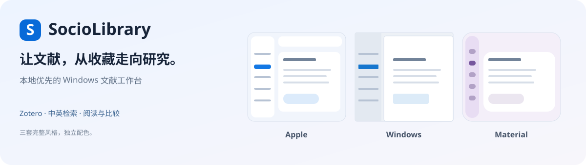

  

<strong>让文献，从收藏走向研究。</strong> 本地文献工作台 · Windows 与 Mac · Zotero 导入 · 中英检索 · 阅读与比较

<a href="https://github.com/Yoesher/SocioLibrary/releases/latest"><strong>下载最新版</strong></a> · <a href="docs/windows.md">开始使用</a> · <a href="docs/README.md">使用文档</a> · <a href="https://github.com/Yoesher/SocioLibrary/issues">反馈问题</a>

## 下载与升级

当前正式版 **0.12.2**，支持 **Windows 10 / 11 x64**，另提供 **macOS 15+ 预览版**。软件自带运行环境，直接安装即可使用。

| 选择 | 下载 | 适合谁 |
| --- | --- | --- |
| 安装版 · 推荐 | [Windows 安装包](https://github.com/Yoesher/SocioLibrary/releases/download/v0.12.2/SocioLibrary-0.12.2-Windows-x64-Setup.exe) | 首次使用；覆盖升级；软件内一键更新 |
| 免安装版 | [Windows 免安装包](https://github.com/Yoesher/SocioLibrary/releases/download/v0.12.2/SocioLibrary-0.12.2-Windows-x64-Portable.zip) | 完整解压后运行，需要自行管理程序文件夹 |

Windows 已有版本可以进入 **软件更新 → 检查更新 → 下载并升级**，也可以关闭软件后运行安装包覆盖升级。原资料库、模型、笔记和设置沿用，升级前先生成本机快照。下载完成后按具体待办保存内容再安装；设置中可核对实际资料目录。0.12.2 增加 Windows 启动进度、安全取消和重复点击恢复窗口，首次升级大库时可明确看到备份与校验阶段。[升级与恢复](docs/windows.md#资料升级与退出) · [版本说明与校验文件](https://github.com/Yoesher/SocioLibrary/releases/latest)

Mac 预览版：[Apple 芯片 ZIP](https://github.com/Yoesher/SocioLibrary/releases/download/v0.12.2/SocioLibrary-0.12.2-macOS-arm64.zip) · [Intel ZIP](https://github.com/Yoesher/SocioLibrary/releases/download/v0.12.2/SocioLibrary-0.12.2-macOS-x86_64.zip)。尚未 Apple 公证；Intel 版暂不附带本地语义运行环境，Mac 扫描页 OCR 和自动替换应用尚未提供。[Mac 安装与范围](docs/macos.md)

## 用它做什么

| 工作 | 在软件中完成 |
| --- | --- |
| 接入文献 | 通过 Zotero 本机接口只读导入书目、本地 PDF、笔记与批注；按变化增量更新 |
| 查找研究 | 中文检索英文文献；字词、语义与混合检索；按作者、年份筛选 |
| 回到原文 | 每篇论文展示来源摘要、与查询的关系和正文命中页；点击在 Zotero 打开对应附件页 |
| 阅读与比较 | 收藏、阅读清单、带出处笔记；相似文献推荐；六维文献对照及导出 |
| 发现关联 | 动态舒展、原位展开、探索返回、来源筛选与可点击概览；图谱与阅读互相跳转 |
| 按需使用 AI | 配置自己的 API 连接，逐次预览并确认材料后提问、归纳、翻译或提取比较草稿 |

个人文献、PDF、笔记、索引和密钥保存在本机。全文检索和规则整理可以独立运行；语义检索使用另行下载的本地模型，云端 AI 由你按次决定是否发送材料。[AI 与资料说明](docs/ai.md) · [导入与同步说明](docs/zotero-research.md)

## 动态文献图谱

**从一篇文献继续探索，保存自己的研究网络。**

- 每次原位展开最多8篇关联，拖动固定节点，随时暂停动态。
- 在动态网络、同心关系和年代脉络之间切换，用概览和图内定位找到目标。
- 按关系来源筛选，查看每条依据；双击进入论文详情，再返回原图。
- 返回/前进恢复本次会话的位置、视角、选中文献和固定状态。

小实心圆点、细连线与侧边标题；标题自动避让，可调整圆点大小和标题密度。

单视图最多80篇，可选择新中心继续探索；自动连线是需要核对的阅读线索。探索返回历史保留在本次打开中；命名保存的研究图谱可跨重开恢复，并导出 Obsidian 画布与文献笔记。[保存图谱与 Obsidian 导出](docs/v0.12-research-workspace.md)

## 自选期刊

在“期刊动态 → 添加期刊”填写官网 RSS / Atom，或使用 Crossref 的 ISSN 接入；可修改来源、暂停及恢复订阅。软件内附具体步骤，失败验证保留原订阅，暂停保留已入库文献。新增文献进入收件箱，可按刊名、未读与收藏筛读；发表日期和首次发现时间分别显示。

例如：`American Sociological Review` → `Crossref · ISSN` → `0003-1224` → 验证并保存 → 立即检查。OpenAlex 需先在本机配置密钥；本机订阅不会自动同步到 GitHub。[完整接入方法](docs/v0.11-graph-and-journals.md)

## 三套风格，一整个工作台

**0.9.0 将界面风格与配色分开。** 在 **资料与设置 → 界面风格** 选择整套设计，先预览，再保存；可以随时取消预览。

| Apple · 轻透工作台 | Windows · 高效工作区 | Material · 灵感空间 |
| --- | --- | --- |
| 悬浮侧栏、轻透工具栏、安静阅读纸面 | 停靠导航、分层工作区、清楚的选中标记 | 窄导航轨、大圆角容器、舒展标题 |
| 圆角控件与轻量过渡 | 方正控件与快速切换 | 胶囊控件与柔和动效 |

导航、卡片、字体层级、控件与切换动画一起变化；图谱统一使用轻量圆点。每套仍可选择配色、墨夜、跟随系统、高对比与紧凑密度；切换时保留当前研究内容。[风格说明与官方参考](docs/v0.9-design-systems.md)

## 三步开始

1. 安装并打开软件；保持 Zotero 运行，在 Zotero 的“设置 → 高级”中允许本机应用通信。
2. 在“资料与设置”选择允许读取的 PDF 文件夹，测试连接并同步 Zotero。
3. 搜索一个研究问题，从摘要、命中页进入阅读、比较或图谱。需要语义检索时再下载模型并建立索引，大库可以先选核心文件夹。

[完整使用说明](docs/windows.md) · [推荐、批注与比较](docs/reading-tools.md) · [AI 连接与发送预览](docs/ai.md)

<strong>期刊更新目前支持哪些来源？</strong>

现已启用《社会》《人口研究》的官网当期与过刊目录，以及《社会学研究》《中国人口科学》的官网当期目录。《社会学评论》《人口学刊》《中国社会科学》仍为来源待接入。只发现元数据与来源链接，全文遵从版权和机构访问限制。

可配置合法 RSS、Crossref 与 OpenAlex；本地按月检查和补查，提示新增与更正。不同来源的历史覆盖范围不同，当前目录快照可能漏掉长期未运行期间的期次。提醒显示在软件内；目前没有邮件或微信推送。[逐刊状态](docs/discovery-research.md) · [定时更新说明](docs/automation.md)

<strong>模型、数据与使用范围</strong>

- 当前 Zotero 导入支持本机个人库，附件保留在原位置，程序不读取或上传 Zotero 数据库。
- 同步清理仅处理本软件的派生索引；重复项只给候选，不自动删除论文或合并 Zotero 条目。
- 语义检索范围以已建立的索引为准；首次大库构建会占用时间和磁盘。跨语言检索的相关性仍需结合具体问题核对。
- AI 为可选项，使用自己的 API 密钥与额度；答复和结构化草稿需要核对来源。
- 图谱自动连线表示阅读线索；实际 PDF 页序、文件页标签与刊物印刷页码可能不同。
- 部分 Windows 机器需要微软 WebView2 Runtime。原 PDF 和完整资料目录仍需自行定期备份。

## 文档与参与

[使用文档](docs/README.md) · [开发与命令](docs/development.md) · [架构](docs/architecture.md) · [验证记录](docs/validation.md) · [版本记录](CHANGELOG.md)

[贡献指南](CONTRIBUTING.md) · [同类项目调研](docs/ecosystem-review-2026-11.md) · [开发计划](ROADMAP.md) · [安全与隐私](SECURITY.md) · [第三方依赖](THIRD_PARTY_NOTICES.md)

采用 [MIT 许可](LICENSE)。欢迎提交可复现的问题与改进建议；问题报告请使用合成示例，并去除私人文献、密钥和个人路径。
