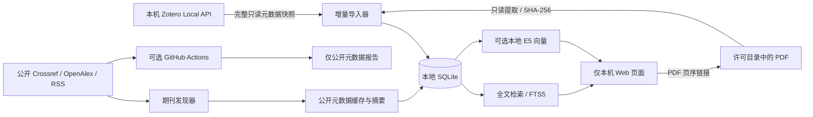

# 架构与 MVP 范围

核实与实现日期：2026-11-06。

## 边界与数据流

FastAPI 提供轻量本机界面；SQLite 统一保存规范化条目、文件指纹、原文片段、FTS5、模型版本化向量和更新水位。无需 Docker、向量数据库服务或云端模型账号。API 仅绑定 `127.0.0.1`，校验 Host、Origin 和会话令牌，页面用文本节点显示文献内容。

## 为什么不直接读取 Zotero 数据库

Local API 是官方支持的本机只读入口，避免活跃 SQLite 文件锁、WAL 一致性和内部 schema 漂移问题。所有请求只允许本机、不使用系统代理、不跟随网络重定向；附件由官方 file/view/url 得到，再按显式本地目录许可核验。元数据导出是兼容退路。没有把 Zotero 数据库复制进项目或 Git 仓库的流程。

官方说明提示 Zotero 10 以前的版本号是同步版本，不保证反映未同步的本地修改，所以首版不以 `since=version` 作为唯一增量依据。Zotero 10 分批读取，逐页核对实例标识、库版本和总数，并在附件路径读取后再次确认；发生变化就拒绝不完整快照。旧版无法核对本地版本时回退单次完整快照。全量元数据核对配合条目指纹、PDF 内容哈希：扫描成本是线性的，重建成本仅随变化文件增长。

## 索引一致性

- 每条记录由“来源标识＋Zotero key”定位；只对同一来源的完整快照执行清理。离线 JSON 导出独立成源。
- SQLite 事务与文件锁防止并发写入；抓取失败不进入导入事务，部分快照拒绝导入。完整书目作为一个事务提交；PDF 逐个提交，中断后可重试并复用已完成的文件，页面会提示导入未完成和旧索引可能未刷新。
- 修改、消失或不再允许访问的 PDF 清除旧片段与旧向量。源 Zotero 文件始终不修改。
- 原文片段不跨页；`page` 是 1 起算 PDF 页序，`page_label` 是 PDF 内置标签。元数据与个人笔记的 `kind` 独立，不伪造页码。
- Windows OCR 为无文字层页面添加派生片段和逐页缓存，不改写 PDF，结果明确标注。加密、损坏、过大文件保留明确状态，不当作索引成功。默认 PDFium 提取器记录索引格式版本，提取器切换后会重建相应 PDF；pypdf 保留作诊断比较。
- 模型 manifest 记录模型与 revision；不同模型索引分开，缺失向量拒绝悄悄退化成“语义搜索”。

## 期刊发现与调度

发现器只接收公开期刊配置，按来源分页查询并返回规范化书目；不接收用户 PDF、笔记或检索问题。两本已核验期刊的 `official_toc` 使用固定官方主机、每次检验 robots.txt，并沿过刊链补查，不下载全文或保存摘要。去重优先 DOI，再使用保守书目特征，不用模糊题名把不同研究强行合并。持久缓存与成功水位均在本地。

每个“期刊＋数据源”独立保存成功日期；当月成功后日常检查跳过，失败只阻止该源水位前移。先完成缓存、报告和本地书目索引，再记录成功。初次回查 90 天，久未运行时补查至上次成功日期。RSS 本身只有近期条目时无法补齐已消失的历史。

GitHub Actions 仅为可选公开元数据任务：无写仓库权限，上传固定两个报告文件；没有私人数据库缓存和跨月持久状态。要实现可靠长期提醒，以本地状态为准，或下一阶段引入明确审查过的公开元数据持久化策略。

## 研究依据

- [Zotero Local API](https://www.zotero.org/support/dev/web_api/v3/local_api)：正式端点、附件 URL、实例标识、版本限制。
- [Crossref REST API](https://www.crossref.org/documentation/retrieve-metadata/rest-api/) 与 [OpenAlex 文档](https://help.openalex.org/api/authentication/)：开放元数据与当前认证边界。详细逐刊实测见 discovery-research.md。
- [GitHub schedule](https://docs.github.com/en/actions/reference/workflows-and-actions/events-that-trigger-workflows#schedule)：默认分支、延迟及无活动停用限制。
- [Sentence Transformers 语义检索](https://www.sbert.net/examples/sentence_transformer/applications/semantic-search/README.html) 与 [E5 模型卡](https://huggingface.co/intfloat/multilingual-e5-small)：向量检索及 query/passage 前缀。
- [pypdf 提取说明](https://pypdf.readthedocs.io/en/stable/user/extract-text.html)：文字层、OCR 边界与内存限制。
- [pypdfium2 接口与许可](https://github.com/pypdfium2-team/pypdfium2)：本地 PDFium 页文本提取与依赖许可；项目依赖的二进制包自带其第三方许可。

## 下一阶段验收任务

1. 在用户机器上以几十篇已熟悉文献验证 Zotero 开关、PDF 目录、实际中文提取和页码链接；保留来源校验记录。
2. 安装本地语义模型，建立中英文社会学问题与人工相关性样本，测量召回率，而不是仅凭可运行判断检索质量。
3. 为七本指定期刊寻找可用官方 feed 或经核实允许的目录渠道；逐刊测试分页、去重、更新与版权边界，再启用。
4. 评估资源受限 PDF 提取进程、群组库和大规模向量索引；之后再扩展带出处的问答和观点比较。升级前一致性备份和 Windows OCR 已实现，完整恢复与 OCR 质量仍需在各自环境核对。

## Windows 升级

固定 Inno Setup AppId 识别原安装，显式沿用目录和任务选项；具名 mutex 防止替换运行中的新版程序。资料目录与程序目录分离，桌面版按显式参数、环境变量、已记住的目录、默认目录的顺序选择资料。缺失的已记住目录会停止启动。

桌面锁先于 Store 创建；初始化持有 library.lock，在任何新版 schema 初始化之前检查版本并创建 SQLite 一致性快照，连同设置写入临时目录，校验后才重命名为完整备份。数据库与设置加载成功后原子写版本记录。保留所有现有表，包括笔记、OCR、向量和订阅水位；不复制模型与原 PDF。数据库备份空间不足或失败时停止；不会自动恢复、清空旧库或删除历史备份。

实现依据：[Inno Setup 复用目录](https://jrsoftware.org/ishelp/topic_setup_usepreviousappdir.htm)、[安装互斥](https://jrsoftware.org/ishelp/topic_setup_appmutex.htm)、[SQLite 在线备份](https://docs.python.org/3/library/sqlite3.html#sqlite3.Connection.backup)。

## 软件内更新（0.4）

UpdateManager 独立于文献写入任务，启动及每小时检查是否达到自动联网间隔，正常 24 小时、失败至少 1 小时；手动检查可立即请求。只读取固定仓库 latest 正式版，严格匹配标签、安装包名称、大小和 digest。下载仅跟随本仓库 HTTPS 地址及固定官方文件主机，限制跳转次数与体积；采用 Range 续传、共享缓存文件锁、有限网络重试及完成后全文件散列核对。下载放在程序缓存而非资料库，不带私有内容或凭证。

网页 API 无安装端点；只有原生桌面桥接可安装已验证的新版本。前端等待未保存编辑、导出、检索及后台任务完成；原生端再次确认任务和文件锁，进入维护状态后拒绝新的写操作。固定 PowerShell 助手经标准输入接收 JSON，不调用 shell 字符串求值，也不修改执行策略。助手先取得父进程句柄并原子确认就绪，等父进程退出，再次核对安装文件，调用安装器，最后用原 data-dir 启动新程序。安装助手成功表示安装器完成并已发起启动；资料加载仍由新版启动检查和版本记录确认。

阅读状态和最近检索独立存于本机 SQLite 表。清单快照没有对源条目的级联删除；历史最多 20 条，写锁忙时跳过可选记录。笔记导出遍历全部未归档记录，以文本块封装正文和摘录，保留已知出处，不将任意笔记文本作为可执行 HTML。

## 明确的规模与安全限制

0.6 添加本机文献工具。书目推荐以 FTS 与标签 SQL 查询获得最多 300 篇候选，加权字词向量排序；语义推荐复用原模型、版本与试点有效性检查，查询阶段在 SQL 排除种子文献，避免长篇占满候选。推荐本身不构建向量，不调用生成式 API。

批注由完整 Local API 快照解析，独立 `zotero_annotations` 保存文字与文献快照，`annotation_chunks` 映射可检索派生片段。只重建改变或索引丢失的批注，摘录／评论各自切分并带类型前缀。文件替换或源条目删除会清理失效片段；独立快照与另存笔记不级联删除。本次未返回的快照标记而不断言源已删除。单页和多页稳定版本快照均有结束复核。

`literature_comparisons` 保存六维单元格、不可自动改写的来源快照、人工核对状态和乐观并发版本。原文变化不改写表格，指纹阻止复用旧片段编号。AI 提取使用独立有期限、单次确认的缓存，输出经完整列／维度及同文献来源校验，只能另存为未核对草稿。导出固定已经核对版本的表格内容，原生保存对话框与安装交接互斥。详见 [阅读工具](reading-tools.md)。

0.5 新增独立的 AI 配置、协议适配和阅读工作区。检索仍由原有本机索引完成；用户显式选取 1–8 个已有片段，服务端核对指纹，生成有期限、单次使用的预览。确认后向用户配置的 HTTPS 或本机回环地址发起一次文本请求，不自动重试或跳转。预览记录绑定连接版本，地址、模型、密钥或片段变化时重新确认。AI 请求持有资料操作锁，防止安装更新关闭尚在进行的请求。

Responses、兼容 Chat、Messages 各自构造请求和提取文本及有限的用量字段；不启用文件、工具、云端会话或任意额外请求参数。Windows DPAPI 密钥绑定连接及目标，设置在资料目录并纳入升级快照。预览和未保存的答复仅驻留有数量与期限上限的内存缓存，显式保存时成为带来源快照和 AI 标记的阅读笔记。来源编号校验只检查是否存在，不验证模型论断。详见 [AI 配置](ai.md)。

本版面向单用户本机。PDF 提取在进程内完成，100 MiB 文件/3000 页/单页内容检查只是常规限制，不能防止所有压缩炸弹或恶意 PDF 的内存耗尽；只处理可信、合法取得的文件。页面服务没有多用户隔离，不适合直接部署公网。全量元数据扫描、逐文件哈希、SQLite 中 JSON 向量的线性比对不是百万篇文献的方案。

0.7新增 `catalog_vectors`（每书目一个本机多语言向量）及 `literature_links`（人工关系和来源快照）。全文试点向量继续独立；智能检索融合离线术语、全库书目语义或已建全文试点，并向界面返回覆盖范围。人工边与标签、题名、语义、比较表候选边分开呈现，只有人工边持久化。外观与自动补齐选项沿用原备份的 `preferences.json`。详见[工作台说明](v0.7-workbench.md)。

## 跨启动器资料位置（0.12.1）

Windows AppData 可能被有包身份的启动器重定向，目录本身与数据库文件可能解析到不同物理位置。桌面入口解析现有数据库文件的实际父目录，在用户主目录的 `.sociolibrary/desktop-location.json` 中记录，兼容旧指针，并在原库失联时停止。未保存内容只阻止退出安装，不阻止下载；具体待办由前端列出并链接到相应编辑区。

依据：[Microsoft MSIX 文件与注册表重定向](https://learn.microsoft.com/en-us/windows/msix/desktop/desktop-to-uwp-behind-the-scenes)。
