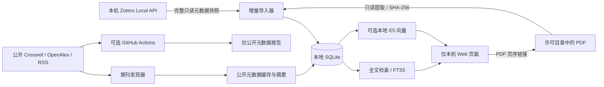

# 架构与 MVP 范围

核实与实现日期：2026-11-06。

## 边界与数据流

FastAPI 提供轻量本机界面；SQLite 统一保存规范化条目、文件指纹、原文片段、FTS5、模型版本化向量和更新水位。无需 Docker、向量数据库服务或云端模型账号。API 仅绑定 `127.0.0.1`，校验 Host、Origin 和会话令牌，页面用文本节点显示文献内容。

## 为什么不直接读取 Zotero 数据库

Local API 是官方支持的本机只读入口，避免活跃 SQLite 文件锁、WAL 一致性和内部 schema 漂移问题。所有请求只允许本机、不使用系统代理、不跟随网络重定向；附件由官方 file/view/url 得到，再按显式本地目录许可核验。元数据导出是兼容退路。没有把 Zotero 数据库复制进项目或 Git 仓库的流程。

官方说明提示 Zotero 10 以前的版本号是同步版本，不保证反映未同步的本地修改，所以首版不以 `since=version` 作为唯一增量依据。Zotero 10 分批读取，逐页核对实例标识、库版本和总数，并在附件路径读取后再次确认；发生变化就拒绝不完整快照。旧版无法核对本地版本时回退单次完整快照。全量元数据核对配合条目指纹、PDF 内容哈希：扫描成本是线性的，重建成本仅随变化文件增长。

## 索引一致性

- 每条记录由“来源标识＋Zotero key”定位；只对同一来源的完整快照执行清理。离线 JSON 导出独立成源。
- SQLite 事务与文件锁防止并发写入；抓取失败不进入导入事务，部分快照拒绝导入。完整书目作为一个事务提交；PDF 逐个提交，中断后可重试并复用已完成的文件，页面会提示导入未完成和旧索引可能未刷新。
- 修改、消失或不再允许访问的 PDF 清除旧片段与旧向量。源 Zotero 文件始终不修改。
- 原文片段不跨页；`page` 是 1 起算 PDF 页序，`page_label` 是 PDF 内置标签。元数据与个人笔记的 `kind` 独立，不伪造页码。
- OCR 未实现。加密、损坏、过大或无文字层文件保留明确状态，不当作索引成功。默认 PDFium 提取器记录索引格式版本，提取器切换后会重建相应 PDF；pypdf 保留作诊断比较。
- 模型 manifest 记录模型与 revision；不同模型索引分开，缺失向量拒绝悄悄退化成“语义搜索”。

## 期刊发现与调度

发现器只接收公开期刊配置，按来源分页查询并返回规范化书目；不接收用户 PDF、笔记或检索问题。两本已核验期刊的 `official_toc` 使用固定官方主机、每次检验 robots.txt，并沿过刊链补查，不下载全文或保存摘要。去重优先 DOI，再使用保守书目特征，不用模糊题名把不同研究强行合并。持久缓存与成功水位均在本地。

每个“期刊＋数据源”独立保存成功日期；当月成功后日常检查跳过，失败只阻止该源水位前移。先完成缓存、报告和本地书目索引，再记录成功。初次回查 90 天，久未运行时补查至上次成功日期。RSS 本身只有近期条目时无法补齐已消失的历史。

GitHub Actions 仅为可选公开元数据任务：无写仓库权限，上传固定两个报告文件；没有私人数据库缓存和跨月持久状态。要实现可靠长期提醒，以本地状态为准，或下一阶段引入明确审查过的公开元数据持久化策略。

## 研究依据

- [Zotero Local API](https://www.zotero.org/support/dev/web_api/v3/local_api)：正式端点、附件 URL、实例标识、版本限制。
- [Crossref REST API](https://www.crossref.org/documentation/retrieve-metadata/rest-api/) 与 [OpenAlex 文档](https://help.openalex.org/api/authentication/)：开放元数据与当前认证边界。详细逐刊实测见 discovery-research.md。
- [GitHub schedule](https://docs.github.com/en/actions/reference/workflows-and-actions/events-that-trigger-workflows#schedule)：默认分支、延迟及无活动停用限制。
- [Sentence Transformers 语义检索](https://www.sbert.net/examples/sentence_transformer/applications/semantic-search/README.html) 与 [E5 模型卡](https://huggingface.co/intfloat/multilingual-e5-small)：向量检索及 query/passage 前缀。
- [pypdf 提取说明](https://pypdf.readthedocs.io/en/stable/user/extract-text.html)：文字层、OCR 边界与内存限制。
- [pypdfium2 接口与许可](https://github.com/pypdfium2-team/pypdfium2)：本地 PDFium 页文本提取与依赖许可；项目依赖的二进制包自带其第三方许可。

## 下一阶段验收任务

1. 在用户机器上以几十篇已熟悉文献验证 Zotero 开关、PDF 目录、实际中文提取和页码链接；保留来源校验记录。
2. 安装本地语义模型，建立中英文社会学问题与人工相关性样本，测量召回率，而不是仅凭可运行判断检索质量。
3. 为七本指定期刊寻找可用官方 feed 或经核实允许的目录渠道；逐刊测试分页、去重、更新与版权边界，再启用。
4. 增加可恢复备份、资源受限 PDF 提取进程、OCR、群组库和大规模向量索引；之后再扩展带出处的问答和观点比较。

## 明确的规模与安全限制

本版面向单用户本机。PDF 提取在进程内完成，100 MiB 文件/3000 页/单页内容检查只是常规限制，不能防止所有压缩炸弹或恶意 PDF 的内存耗尽；只处理可信、合法取得的文件。页面服务没有多用户隔离，不适合直接部署公网。全量元数据扫描、逐文件哈希、SQLite 中 JSON 向量的线性比对不是百万篇文献的方案。
