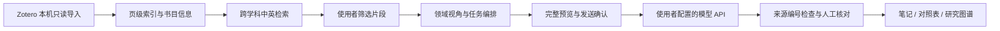

# 参赛定位与准备说明

核对日期：2026-11-13。依据[华中师范大学第二届教育智能体设计大赛通知](https://ecard.ccnu.edu.cn/info/1013/6769.htm)及使用者提供的通知全文整理。当前只准备软件与说明，不代填身份信息，不自动提交参赛作品。

## 建议定位

所属主题：**科研增效**。建议参赛作品标题：**SocioLibrary：社会科学证据研究智能体**。软件显示名称继续使用 SocioLibrary。

作品面向社会科学师生“文献已收藏、论证依据难以重新找到”的日常需求，将 Zotero 资料、多语检索、原文定位、证据选择、模型阅读、结构化比较和研究积累串成可复查的工作流。使用者掌握研究问题、材料选择和对外发送；模型负责对已选材料作有出处的整理与比较。

其智能体形态是**由使用者确认关键步骤的受控工作流**：程序调用本地检索、来源校验、比较表及笔记工具，按明确的任务提示组织输入，接收模型结果后校验来源编号，并由使用者核对、保存。当前不包含由模型自行决定工具调用、后台自主阅读全文或无人监督的多智能体协作；答辩展示应与此一致。

## 开发平台、架构与模型来源

自研 Python / FastAPI / SQLite 工作流；桌面窗口由 pywebview 提供，图谱使用 Cytoscape.js。Zotero 本机接口承担只读导入，页级文本索引与可选多语言 E5 模型用于本地检索。技术依赖与许可见 [THIRD_PARTY_NOTICES](../THIRD_PARTY_NOTICES.md)。

生成式 AI 使用参赛者自己配置的 API，可采用 OpenAI Responses、兼容 Chat Completions 或 Anthropic Messages 协议；具体模型、接收地址和发送材料在每次预览中显示。学校 HiAgent 尚未集成，不能在参赛信息中填写“基于学校 HiAgent 开发”。也不能将第三方模型、开源依赖或原论文描述为自研成果。

公开演示应使用合法公开资料或项目的原创合成演示库。不要打包私人 Zotero 数据库、论文全文、笔记或 API 密钥；评委可自行配置连接，或按完整预览录像查看模型环节。

## 本轮实质改动

| 方面 | 可演示的行为 |
| --- | --- |
| 适用范围 | 11 个研究视角与跨学科中英概念、方法术语扩展；切换视角不排除其他学科文献 |
| 工作流 | 从检索页准备方法审读、证据与分歧梳理、综述提纲，再选择材料并核对发送范围 |
| 研究传统 | 定量、质性、历史、规范与理论材料采用相应的证据提示，不强行套用单一研究模板 |
| 来源校验 | 页码、摘录快照、比较表逐格来源及单次发送预览继续沿用；改变视角后必须重新预览 |
| 学科接入 | 提供十种期刊配置起点；仅预填，由使用者验证后启用 |
| 可复现展示 | 可在全新目录生成十份明确标注的原创合成文档，不需要展示私有研究库 |

## 五分钟演示建议

| 时间 | 演示内容 |
| --- | --- |
| 0:00–0:35 | 用“收藏之后如何找回证据”说明研究场景，展示本地数据与 Zotero 接入 |
| 0:35–1:25 | 切换教育、历史等视角，用中文寻找英文材料，查看摘要、查询关系和命中页 |
| 1:25–2:30 | 选择两篇材料，准备方法审读或证据梳理，核对模型、全文提示和具体发送内容 |
| 2:30–3:40 | 展示标明草稿的结果，回查出处、保留材料不足，比较研究问题与方法 |
| 3:40–4:35 | 将人工核对结果保存为笔记或对照表，展开文献图谱、保存研究线索 |
| 4:35–5:00 | 交代跨学科适用范围、数据边界、可复现实测和当前局限 |

如果使用合成库，要在开场和摘要位置标明“功能演示，非真实论文”。不要把合成例子包装成真实研究成效或用户反馈。模型输出质量需要用获得授权的真实材料单独评估。

## 提交前仍需补齐

通知要求在 **2026-11-30 23:59** 前提交基本信息、PDF 使用文档、在线演示链接或可运行工具，以及演示视频。参赛者姓名、学院、团队成员、参赛经历和联系方式由本人填写。可运行工具应与文档中描述的版本一致。

学校[首届比赛报道](https://news.ccnu.edu.cn/info/1002/21077.htm)提到“一站式学术助手”等科研工具，但未公开其完整功能和评审资料。当前不能证明与所有首届获奖作品不存在雷同；需取得获奖作品说明后逐项核对研究场景、核心流程和新增内容。是否符合原创及重复参赛要求由组委会认定。

提交材料应分开报告：源代码与合成测试已验证的行为、安装包与桌面测试结果、获得授权的真实材料质量评估。不得把“成功运行”直接写为“显著提高科研效率”。
